  <!-- Minimalist Hanging Lanyard Engineer Pass -->
  

    

  <h1>Shamith R</h1>
  
<strong>Full-Stack Engineer &amp; Creative Developer</strong>

  
Building high-performance web applications, interactive interfaces, and developer tooling.

  

    
    
    
  

---

### 📌 About Me

- 💻 Passionate about building fast, responsive full-stack applications with clean architectures.
- 🎨 Focused on modern frontend systems (TypeScript, React, Canvas 2D) and reliable backends (Node.js, Express, Python).
- 🔄 **Real-Time Push Radar**: This repository automatically syncs with my GitHub activity whenever I push code.

---

### ⚡ Live Repositories & Recent Projects

> *This table automatically updates via GitHub Actions whenever I push to any repository.*

<!-- RECENT_REPOS:START -->

| ⚡ Project / Repository | 🛠️ Tech Stack | ⭐ Stars | 🕒 Last Pushed |
| :--- | :--- | :---: | :--- |
| [**rshamith777-cpu.github.io-**](https://github.com/rshamith777-cpu/rshamith777-cpu.github.io-) `🔥 RECENT` |  | ⭐ `0` | 🕒 `6 hrs ago` |
| [**percepta**](https://github.com/rshamith777-cpu/percepta) Percepta: Physical-world multimodal vision copilot with real-time AR bullse... |  | ⭐ `0` | 🕒 `7 hrs ago` |
| [**hakku-ai**](https://github.com/rshamith777-cpu/hakku-ai) 🏛️ Hakku 5.0 (ಹಕ್ಕು / हक़) — Sovereign Citizen Welfare Discovery & Statuto... |  | ⭐ `0` | 🕒 `13 hrs ago` |
| [**AIML_1_ImageClassification_byte**](https://github.com/rshamith777-cpu/AIML_1_ImageClassification_byte) Cats vs Dogs image classifier using TensorFlow/Keras and MobileNetV2 transf... |  | ⭐ `0` | 🕒 `10 days ago` |
| [**AIML_2_SpamClassifier_byte**](https://github.com/rshamith777-cpu/AIML_2_SpamClassifier_byte) End-to-end binary NLP spam SMS classification pipeline using TF-IDF & Logis... |  | ⭐ `0` | 🕒 `10 days ago` |
| [**AIML_3_CustomerSegmentation_byte**](https://github.com/rshamith777-cpu/AIML_3_CustomerSegmentation_byte) Customer Segmentation & Behavioral Profiling using K-Means Clustering (k=5,... |  | ⭐ `0` | 🕒 `10 days ago` |
| [**PhishGuard**](https://github.com/rshamith777-cpu/PhishGuard) Local-first phishing URL awareness and intelligence platform featuring 12 d... |  | ⭐ `0` | 🕒 `11 days ago` |
| [**Hackerrank-Oct-26**](https://github.com/rshamith777-cpu/Hackerrank-Oct-26) | `Code` | ⭐ `0` | 🕒 `18 days ago` |
| [**SeedIQ**](https://github.com/rshamith777-cpu/SeedIQ) **SeedIQ is a hybrid AI and Quantum Machine Learning platform for agricultu... |  | ⭐ `0` | 🕒 `26 days ago` |
| [**vayra**](https://github.com/rshamith777-cpu/vayra) VAYRA is an AI-driven hyper-local severe weather nowcasting system for Utta... |  | ⭐ `0` | 🕒 `10/12/2026` |
| [**CS_2_PortScanner_BYTE**](https://github.com/rshamith777-cpu/CS_2_PortScanner_BYTE) A Python TCP port scanner for authorized security testing, supporting confi... |  | ⭐ `0` | 🕒 `10/7/2026` |
| [**CS_1_PasswordStrengthChecker_BYTE**](https://github.com/rshamith777-cpu/CS_1_PasswordStrengthChecker_BYTE) A privacy-first Python password strength checker that scores passwords, det... |  | ⭐ `0` | 🕒 `10/7/2026` |
| [**Skill-Gap-AI**](https://github.com/rshamith777-cpu/Skill-Gap-AI) **SkillGapAI is a personalized career-learning decision platform that analy... |  | ⭐ `0` | 🕒 `10/6/2026` |
| [**proofit**](https://github.com/rshamith777-cpu/proofit) PROOFIT 2.2 — Evidence-first hiring with tamper-evident reports. Compare ca... |  | ⭐ `0` | 🕒 `10/4/2026` |
| [**DECIDIO**](https://github.com/rshamith777-cpu/DECIDIO) AI-powered decision simulation that explores Commit, Wait, and Skip futures... |  | ⭐ `0` | 🕒 `10/1/2026` |
| [**devyra-ai**](https://github.com/rshamith777-cpu/devyra-ai) Devyra is an AI Decision Reliability Platform that stress-tests critical bu... |  | ⭐ `0` | 🕒 `10/1/2026` |
| [**forge-x**](https://github.com/rshamith777-cpu/forge-x) Organizational Decision Reliability Engine that grounds AI decisions, stres... |  | ⭐ `0` | 🕒 `9/27/2026` |
| [**AEGIS-ZERO**](https://github.com/rshamith777-cpu/AEGIS-ZERO) AEGIS ZERO is a physical-digital twin for complex infrastructure. Powered b... |  | ⭐ `0` | 🕒 `9/26/2026` |
| [**Afterlife**](https://github.com/rshamith777-cpu/Afterlife) AFTERLIFE is an autonomous AI agent that turns life events into action. It ... |  | ⭐ `0` | 🕒 `9/14/2026` |
| [**Emberwatch**](https://github.com/rshamith777-cpu/Emberwatch) EmberWatch is an AI-powered 3D wildfire intelligence platform. It tracks re... |  | ⭐ `0` | 🕒 `9/14/2026` |
| [**nexus-agent**](https://github.com/rshamith777-cpu/nexus-agent) NEXUS: Autonomous Mission Control Agent. Turns outcomes into verified actio... |  | ⭐ `0` | 🕒 `9/14/2026` |
| [**-Buy-or-Wait-AI-hackerrank-September-**](https://github.com/rshamith777-cpu/-Buy-or-Wait-AI-hackerrank-September-) AI-powered financial decision agent that evaluates whether a purchase is sa... |  | ⭐ `0` | 🕒 `9/13/2026` |
| [**personal-gemini-journal**](https://github.com/rshamith777-cpu/personal-gemini-journal) |  | ⭐ `0` | 🕒 `9/6/2026` |
| [**razorpay-hackathon-payguard-**](https://github.com/rshamith777-cpu/razorpay-hackathon-payguard-) PayGuard AI detects payment anomalies, calculates financial exposure, and g... |  | ⭐ `0` | 🕒 `9/5/2026` |
| [**codsoft_tasks**](https://github.com/rshamith777-cpu/codsoft_tasks) Completed cybersecurity projects for CODSOFT Internship (August Batch C16) ... |  | ⭐ `0` | 🕒 `9/4/2026` |
| [**oppurtunity-OS**](https://github.com/rshamith777-cpu/oppurtunity-OS) OpportunityOS is an agent-native workspace connecting AI with elite opportu... |  | ⭐ `0` | 🕒 `9/3/2026` |
| [**ResearchPilot-**](https://github.com/rshamith777-cpu/ResearchPilot-) ResearchPilot is an autonomous multi-agent deep research engine. Features r... |  | ⭐ `0` | 🕒 `8/31/2026` |
| [**eventnexus**](https://github.com/rshamith777-cpu/eventnexus) EventNexus — Smart Event Management Platform for PromptWars × AbhiyantriX... |  | ⭐ `0` | 🕒 `8/29/2026` |
| [**lanevision-ai**](https://github.com/rshamith777-cpu/lanevision-ai) Real-time automotive computer vision & ADAS perception control center featu... |  | ⭐ `0` | 🕒 `8/28/2026` |
| [**AI-KOS**](https://github.com/rshamith777-cpu/AI-KOS) AI-KOS Enterprise is an AI-powered knowledge intelligence platform that tra... |  | ⭐ `0` | 🕒 `8/26/2026` |
| [**venturepilot-ai**](https://github.com/rshamith777-cpu/venturepilot-ai) Autonomous AI Startup CEO workspace powered by Google Gemini 3.6 Flash. Fea... |  | ⭐ `1` | 🕒 `8/17/2026` |
| [**f1-telemetry-analysis-tool**](https://github.com/rshamith777-cpu/f1-telemetry-analysis-tool) APEX Race Intelligence OS is a high-performance Formula 1 telemetry platfor... |  | ⭐ `2` | 🕒 `8/9/2026` |
| [**messagepilot-ai**](https://github.com/rshamith777-cpu/messagepilot-ai) MessagePilot AI is a hybrid intelligent notification routing system that an... |  | ⭐ `0` | 🕒 `8/2/2026` |
| [**PharmaQMS-AI**](https://github.com/rshamith777-cpu/PharmaQMS-AI) Enterprise Pharma Quality Management System with AI Copilot, LangGraph work... |  | ⭐ `0` | 🕒 `7/28/2026` |
| [**PortfolioX_CMS**](https://github.com/rshamith777-cpu/PortfolioX_CMS) A full-stack portfolio & blog CMS built with Next.js 15, Express, TS, and M... |  | ⭐ `2` | 🕒 `6/19/2026` |
| [**accredian-enterprise-landing-page**](https://github.com/rshamith777-cpu/accredian-enterprise-landing-page) A modern, production-ready enterprise SaaS landing page built with Next.js ... |  | ⭐ `1` | 🕒 `7/22/2026` |
| [**trading-bot-binance-testnet**](https://github.com/rshamith777-cpu/trading-bot-binance-testnet) Built a Python CLI trading bot for Binance Futures Testnet supporting MARKE... |  | ⭐ `1` | 🕒 `7/23/2026` |
| [**querycraft**](https://github.com/rshamith777-cpu/querycraft) |  | ⭐ `2` | 🕒 `11/17/2025` |
| [**chefgpt**](https://github.com/rshamith777-cpu/chefgpt) AI Kitchen Assistant: A Flask-powered web app using Grok AI to generate cus... |  | ⭐ `1` | 🕒 `4/23/2026` |
| [**Realtime-satellite-tracking**](https://github.com/rshamith777-cpu/Realtime-satellite-tracking) Satellite-X is an immersive 3D mission control dashboard built with Three.j... |  | ⭐ `1` | 🕒 `4/28/2026` |
| [**taskflow-ai**](https://github.com/rshamith777-cpu/taskflow-ai) TaskFlow AI: A production-grade multi-tenant enterprise project & task mana... |  | ⭐ `1` | 🕒 `6/14/2026` |
| [**LinkSphere**](https://github.com/rshamith777-cpu/LinkSphere) **LinkSphere**: An AI-powered SaaS Link Intelligence Platform featuring sma... |  | ⭐ `1` | 🕒 `6/14/2026` |
| [**ChatSphere**](https://github.com/rshamith777-cpu/ChatSphere) An intelligent, client-side real-time workspace built with React & Vite. Po... |  | ⭐ `1` | 🕒 `6/19/2026` |

*Last auto-synchronized with GitHub on: `Thu, 12 Nov 2026 04:38:10 GMT`*

<!-- RECENT_REPOS:END -->

---

### 🛠️ Tech Stack & Tools

<table>
  <tr>
    <td align="center" width="25%">
      <strong>Frontend</strong>  
      <code>TypeScript</code> 
      <code>JavaScript (ES6+)</code> 
      <code>React / Next.js</code> 
      <code>HTML5 & CSS3</code> 
      <code>Tailwind CSS</code>
    </td>
    <td align="center" width="25%">
      <strong>Backend & APIs</strong>  
      <code>Node.js</code> 
      <code>Express.js</code> 
      <code>Python</code> 
      <code>RESTful APIs</code> 
      <code>Web Audio API</code>
    </td>
    <td align="center" width="25%">
      <strong>DevOps & Tools</strong>  
      <code>Git & GitHub</code> 
      <code>GitHub Actions (CI/CD)</code> 
      <code>Linux / Bash</code> 
      <code>VS Code</code> 
      <code>Postman</code>
    </td>
    <td align="center" width="25%">
      <strong>Focus Areas</strong>  
      <code>Web Performance</code> 
      <code>Interactive UI</code> 
      <code>State Management</code> 
      <code>Modular Systems</code> 
      <code>Canvas & 2D Physics</code>
    </td>
  </tr>
</table>

---

### 🐍 Contribution Activity

  <picture>
    <source media="(prefers-color-scheme: dark)" srcset="https://raw.githubusercontent.com/rshamith777-cpu/rshamith777-cpu.github.io-/main/dist/github-contribution-grid-snake-dark.svg">
    <source media="(prefers-color-scheme: light)" srcset="https://raw.githubusercontent.com/rshamith777-cpu/rshamith777-cpu.github.io-/main/dist/github-contribution-grid-snake.svg">
    
  </picture>

---

  Designed &amp; programmed by <strong>Shamith R</strong> • Synchronized live with GitHub

